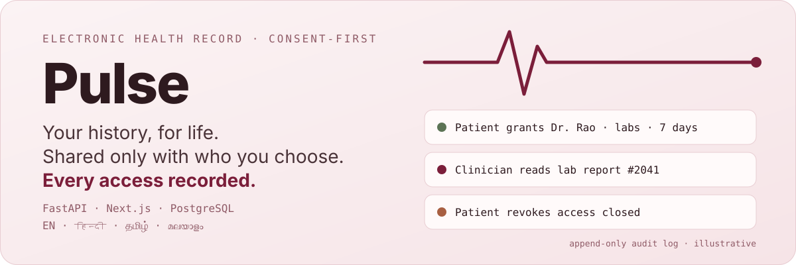
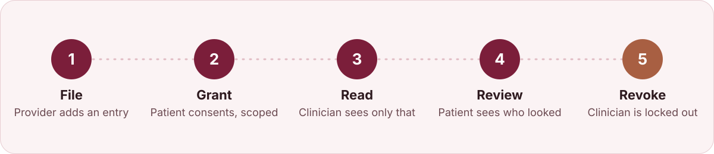
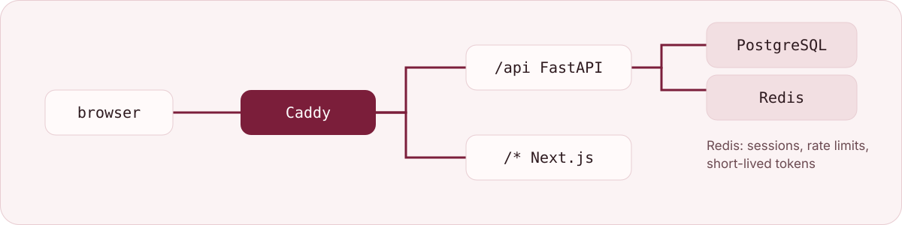

<h1 align="center">Pulse</h1>

<p align="center">
  
</p>

[](https://github.com/moneytosms/Pulse/actions/workflows/ci.yml)
[](https://moneytosms.github.io/Pulse/)


A lifelong electronic health record platform. Patients own their medical history; providers contribute to it; clinicians read it only with the patient's consent, and every access is recorded.

Built for an Indian demographic, in English, Hindi, Tamil and Malayalam. An academic project — it never touches real patient data — held to real engineering practice.

Project site: <https://moneytosms.github.io/Pulse/> · Guide: <https://moneytosms.github.io/Pulse/guide/>

## Highlights

- **Patient-owned history.** Entries, documents and corrections live under the patient, not the provider.
- **Consent-gated reads.** Clinicians see nothing until the patient grants scoped access, confirmed with their password; revoking locks them out immediately.
- **Everything audited.** Every access is recorded and visible to the patient as access history.
- **Emergency access.** A scoped, logged break-glass path for urgent care.
- **Four portals.** Patient, clinician, provider staff and administrator, each with its own view.
- **Multilingual UI.** English, Hindi, Tamil and Malayalam. The interface is localised; clinical data is not.
- **Reproducible demo.** Seeded with Synthea plus an Indian overlay; one `docker compose up` brings the whole stack online.

## Status

**Phases 0–4 and P4.5 packaging are complete; locale review is outstanding (Hindi, Tamil and Malayalam are unreviewed by native speakers, see [`docs/locale-review.md`](docs/locale-review.md)).** Records, consent and the demo portals are implemented. The stack includes entry filing/corrections, persistent documents, scoped consent and emergency access, audit history, localized notifications, computed analytics and administrator duplicate review. See [`docs/verification-and-operations.md`](docs/verification-and-operations.md) for checks, operational limits and remaining product workflows.

| | |
|---|---|
| Architecture | Locked. See [`docs/architecture.md`](docs/architecture.md) |
| Domain model | Locked. See [`docs/domain-model.md`](docs/domain-model.md) |
| API contract | Locked. See [`docs/api-conventions.md`](docs/api-conventions.md) |
| Decisions | 16 ADRs in [`docs/adr/`](docs/adr/) |
| Delivery plan | [`docs/delivery-plan.md`](docs/delivery-plan.md), tracked on [#17](https://github.com/moneytosms/Pulse/issues/17) |
| Build order | [#22](https://github.com/moneytosms/Pulse/issues/22) — every step, its blocker, and who waits on it |
| Code | `backend/` (FastAPI, real-database integration tests) · `frontend/` (Next.js) · `seed/` (Synthea + Indian overlay) |

## Quickstart

The whole system comes up on any machine with Docker:

```bash
git clone https://github.com/moneytosms/Pulse.git
cd Pulse
docker compose up --build -d --wait
```

On first boot the backend runs migrations and seeds identity data. Then:

- App: `http://localhost` — try `/en/register`, or `/en/login`
- Mailpit inbox (default local verification emails): `http://localhost:8025`; Gmail SMTP setup is in [`docs/demo.md`](docs/demo.md)
- Seeded patient login: `demo.patient.hi@example.com` / `Pulse@demo1` (also `demo.patient.en@example.com`; see [`seed/README.md`](seed/README.md))

Demo journey:

<p align="center">
  
</p>

In words: provider files an entry → patient grants clinician access with password confirmation → clinician reads → patient reviews access history → patient revokes → clinician is locked out. The live browser suite rehearses this through Caddy.

## Shape

A modular monolith: one FastAPI application, one PostgreSQL database, organised by business domain.

<p align="center">
  
</p>

Modules: `auth · users · patients · providers · records · consent · audit · notifications · analytics · admin`

## Reading order

Start with the [`documentation index`](docs/README.md) to choose a reading path. For the product from a user's point of view, read the [end-to-end workflow map](docs/workflows/README.md). Then use [`CONTEXT.md`](CONTEXT.md) as the glossary. Terms in this project mean specific things, and two distinctions carry the whole design: **Consent is not Permission**, and **the interface is localised, clinical data is not**.

Then [`docs/architecture.md`](docs/architecture.md) for how it is built, [`docs/domain-model.md`](docs/domain-model.md) for the entities, [`docs/api-conventions.md`](docs/api-conventions.md) for what every endpoint looks like, and [`docs/adr/`](docs/adr/) for the decisions that were expensive enough to write down.

[`docs/learnings.md`](docs/learnings.md) explains every non-obvious pattern in the codebase — what it is, why it is here, what it replaces. The point of it is that anyone on the team can explain any part of the project, including the parts they did not type.

## Team

| | |
|---|---|
| Shivansh | Database — models, migrations, repositories, seed data |
| Akshay | Backend — FastAPI, services, schemas, auth, adapters |
| Bharadwaj | Frontend — Next.js, design system, i18n, four portals |
| Srimoney | Platform, CI, integration, review, deployment |

Work is sliced in [`docs/delivery-plan.md`](docs/delivery-plan.md).

## Not in scope

ABHA/ABDM live integration · real SMS delivery (email goes to Mailpit by default, with optional Gmail SMTP) · DPDP certification · native mobile apps · FHIR export · OCR of uploaded documents · ML · multi-tenancy · Kubernetes.

The design is DPDP-shaped and takes ABDM's consent framework as inspiration. Neither is a compliance claim.
